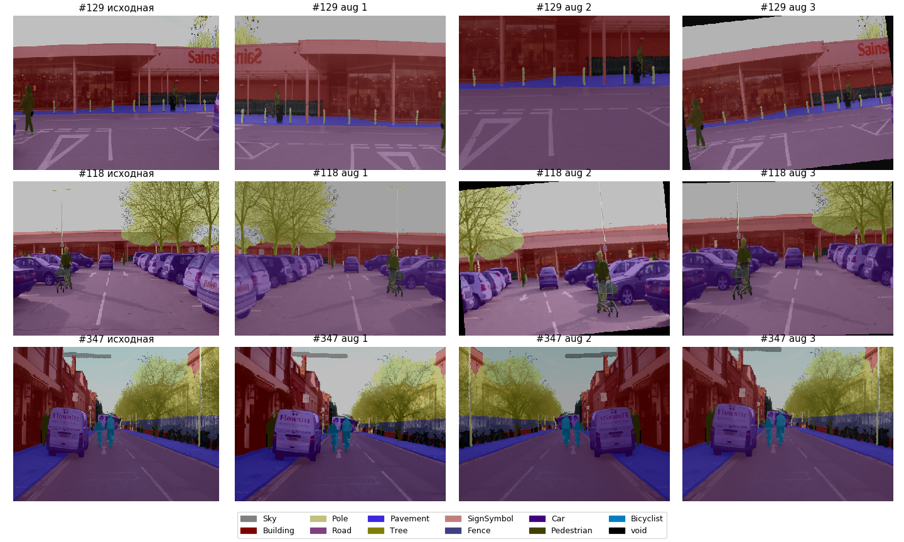
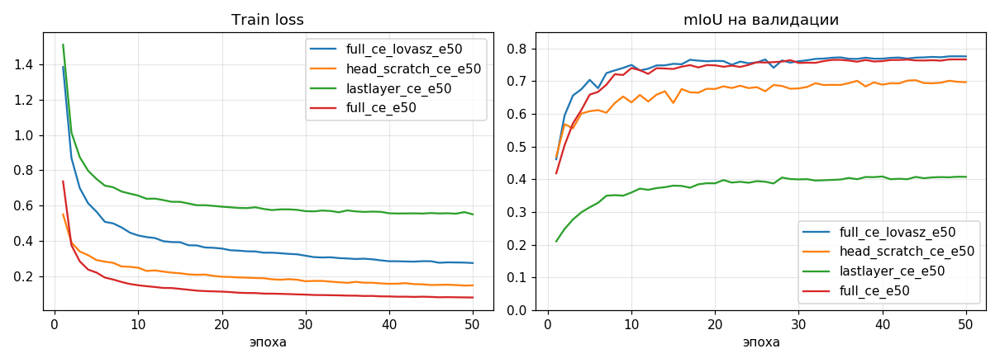
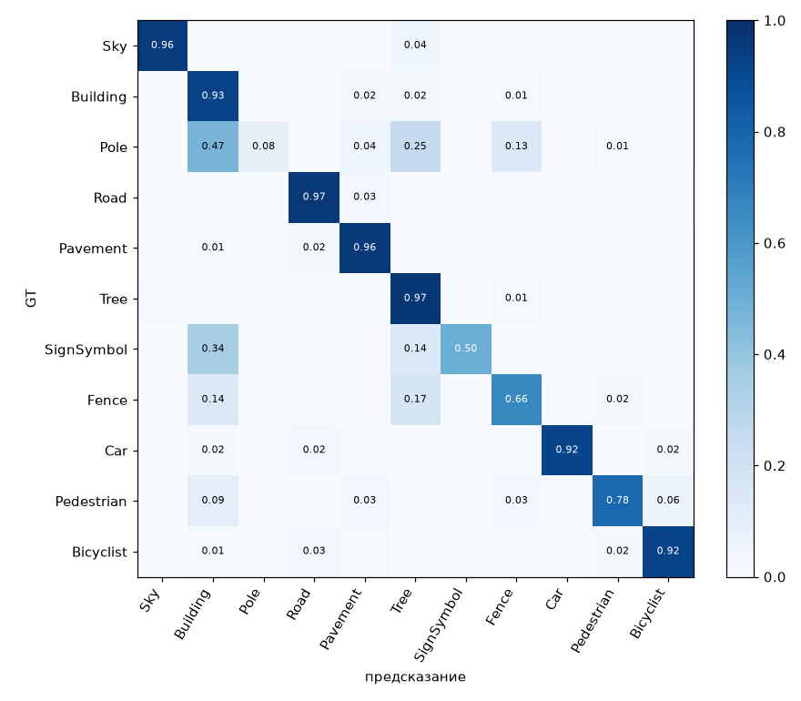
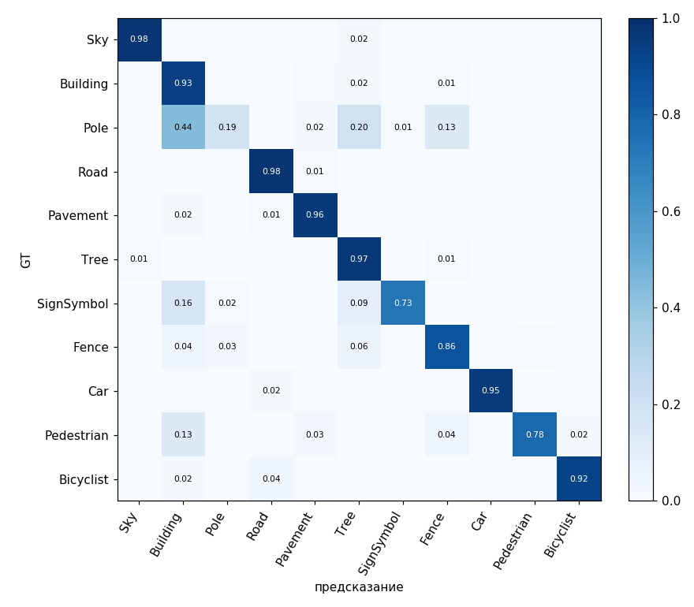
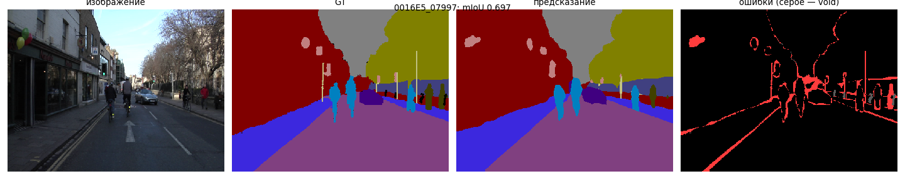
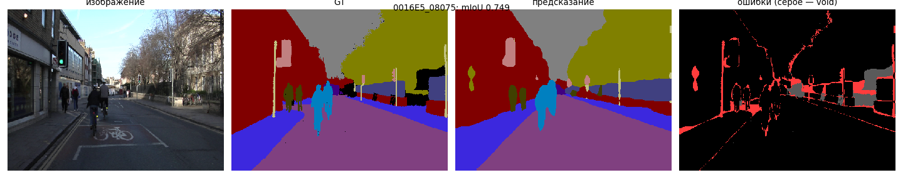
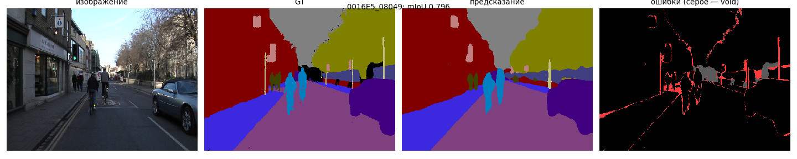

# Дообучение модели сегментации под новые классы (CamVid)

**Итог.** Предобученная DeepLabV3-ResNet50 дообучена на 11 классов CamVid. Три уровня обучения сравнивались при одинаковом бюджете: 50 эпох, батч 4, seed 42.

| Что обучается | mIoU, val | mIoU, test | Время эпохи | Память обучения |
|---|---|---|---|---|
| только выходной слой (`lastlayer`) | 0.409 | 0.404 | 6.2 с | 420 МБ |
| вся голова с нуля, энкодер заморожен (`head_scratch`) | 0.703 | 0.596 | 9.8 с | 626 МБ |
| вся модель (`full`) | **0.766** | **0.685** | 19.7 с | 2 102 МБ |

**Главные выводы:**
- **Обучения одного выходного слоя недостаточно.** Старая голова сводит новые классы к «фону» VOC.
- **Переобучение всей головы при замороженном энкодере** закрывает 82% разрыва `lastlayer`–`full` на валидации, но только 68% на тесте. На незнакомых улицах адаптация энкодера важнее.
- **Функция потерь.** CE + Lovász поднимает mIoU `full` на +0.010 и на валидации, и на тесте. Взвешенная CE ухудшает его на 0.02.
- **Flip-TTA** добавляет ~0.005.

## 1. Данные

**Датасет:** CamVid в версии SegNet-Tutorial: 367 / 101 / 233 кадров (train / val / test), 480×360. Маски одноканальные, в индексах: 0–10 — классы, 11 — void (не учитывается ни в loss, ни в метрике).

| Индекс | 0 | 1 | 2 | 3 | 4 | 5 | 6 | 7 | 8 | 9 | 10 | 11 |
|---|---|---|---|---|---|---|---|---|---|---|---|---|
| Класс | Sky | Building | Pole | Road | Pavement | Tree | SignSymbol | Fence | Car | Pedestrian | Bicyclist | void |

Распределение классов сильно несбалансировано: дорога, небо и здания занимают большую часть пикселей, столбы, знаки и велосипедисты — малую долю.

**Проверки загрузки** (`check_augs.py`):
- имена картинок и масок попарно совпадают во всех сплитах;
- после аугментаций значения масок остаются в {0…11}, тип int64, форма маски совпадает с формой картинки;
- батчи собираются: train `(4, 3, 352, 480)`, val `(4, 3, 360, 480)`;
- визуально маска совпадает с объектами после кропа, отражения и поворота (рис. 1).

**Аугментации** (`torchvision.transforms.v2`, картинка и маска передаются одним вызовом):

| Преобразование | Параметры | К маске |
|---|---|---|
| RandomResizedCrop | 352×480, scale 0.5–1.0 | да, nearest |
| RandomHorizontalFlip | p = 0.5 | да |
| RandomAffine (поворот) | ±10°, p = 0.3 | да, nearest; пиксели за краем → void |
| ColorJitter | яркость, контраст, насыщенность 0.3 | нет |
| Normalize | ImageNet mean/std | нет |

На валидации и тесте используется только нормализация, кадр подаётся целиком (360×480).



## 2. Модель

**Исходная модель:** `torchvision` DeepLabV3-ResNet50 с весами `DeepLabV3_ResNet50_Weights.COCO_WITH_VOC_LABELS_V1`.

| Этап | Данные | Задача | Классов |
|---|---|---|---|
| 1. Энкодер ResNet-50 | ImageNet | классификация изображений | 1 000 |
| 2. Вся DeepLabV3 | изображения COCO с объектами 20 категорий VOC | сегментация | 21 (фон + 20 VOC) |
| 3. Эта работа | CamVid | сегментация городских сцен | 11 |


**Настройка выхода под число классов.** Выходной слой `classifier[4]` = `Conv2d(256, 21, 1)` заменён на `Conv2d(256, 11, 1)` со случайной инициализацией. В режиме `head_scratch` вместо замены одного слоя вся `DeepLabHead` создаётся заново со случайными весами (раздел 3); архитектура и число параметров при этом не меняются. Вспомогательная голова (`aux_classifier`) отключена. Итог: 39.64 M параметров, 107.8 GMACs на кадр 360×480.

После замены модель предсказывает только 11 классов CamVid. Старые 21 класс VOC не сохраняются: выходной слой заменён, а не дополнен. Классы почти не пересекаются: из CamVid в VOC есть Car, Pedestrian (person) и частично Bicyclist (person + bicycle), а Sky, Building, Road, Pavement, Tree, Pole, SignSymbol и Fence в VOC относились к одному классу background. Поэтому задача действительно сводится к обучению под новые классы.

## 3. Протокол экспериментов

**Что считается «выходной головой».** По материалу задания (D2L, глава Fine-Tuning) у ResNet-18 заменяется и сравнивается выходной слой `fc`. Прямой аналог в DeepLabV3 — финальная свёртка 1×1 `classifier[4]`: это тот же линейный слой, применённый к каждому пикселю. Это основной вариант **`lastlayer`** (linear probing).

У DeepLabV3, в отличие от классификационной ResNet, перед выходным слоем стоит большой обучаемый блок ASPP. Поэтому дополнительно проверено переобучение всей `DeepLabHead` при замороженном энкодере — **`head`**.

| | `lastlayer` | `head_scratch` | `head_pretrained` | `full` |
|---|---|---|---|---|
| ResNet-50 | заморожен | заморожен | заморожен | учится, LR 1e-4 |
| ASPP + conv 3×3 + BN | заморожены (веса COCO) | **новые случайные**, LR 1e-3 | старт с COCO, LR 1e-3 или 1e-4 | старт с COCO, LR 1e-4 |
| conv 1×1 → 11 | новый, LR 1e-3 | новый, LR 1e-3 | новый, LR 1e-3 | новый, LR 1e-3 |
| Обучаемых параметров | 2 827 | 16.13 M | 16.13 M | 39.64 M |
| BatchNorm | все в `eval()` | энкодер `eval()`, голова `train()` | энкодер `eval()`, голова `train()` | все `train()` |

`head_pretrained` — дополнительная проверка (раздел 4.2): нужны ли голове веса COCO.

**Общее для всех:** 50 эпох, батч 4, seed 42, AdamW (wd 1e-4), poly-расписание LR (степень 0.9, шаг на каждый батч), CrossEntropy с `ignore_index = 11`, AMP fp16. Режим `full` повторяет рецепт D2L: вся сеть дообучается, у нового выходного слоя LR в 10 раз больше.

Замороженные части переведены в `eval()`. Иначе BatchNorm продолжал бы обновлять running-статистики, хотя веса заморожены.

**Метрики.**
- mIoU считается по confusion matrix, накопленной по всей выборке, без пикселей void. Это не среднее mIoU по батчам.
- Лучшая эпоха выбирается по валидации.
- Итоговое качество дополнительно измерено на тестовой выборке (233 кадра), которая в обучении и выборе модели не участвовала.

## 4. Результаты

| Метрика | `lastlayer` | `head_scratch` | `full` |
|---|---|---|---|
| Обучаемых параметров | 0.003 M | 16.13 M | 39.64 M |
| **mIoU, val** | **0.409** | **0.703** | **0.766** |
| **mIoU, test** | **0.404** | **0.596** | **0.685** |
| Pixel accuracy, val / test | 0.741 / 0.748 | 0.933 / 0.877 | 0.951 / 0.919 |
| Лучшая эпоха | 40 | 44 | 49 |
| mIoU на последней эпохе (val) | 0.407 | 0.697 | 0.766 |
| Время эпохи | 6.2 с | 9.8 с | 19.7 с |
| Время обучения (50 эпох) | 7.7 мин | 10.2 мин | 18.3 мин |
| Пиковая память обучения | 420 МБ | 626 МБ | 2 102 МБ |
| Параметры / GMACs | 39.64 M / 107.8 | то же | то же |
| Задержка fp32 / fp16, batch 1 | 28.6 / 15.9 мс | 29.3 / 16.4 мс | 28.8 / 16.1 мс |
| Память инференса fp32 | 254 МБ | 255 МБ | 254 МБ |

Архитектура у всех вариантов одна, поэтому параметры, GMACs, задержка и память инференса совпадают в пределах шума. Различаются только качество и стоимость обучения.



### 4.1. IoU по классам

| Класс | `lastlayer` val / test | `head_scratch` val / test | `full` val / test |
|---|---|---|---|
| Road | 0.728 / 0.749 | 0.956 / 0.872 | 0.973 / 0.957 |
| Sky | 0.698 / 0.700 | 0.924 / 0.881 | 0.931 / 0.905 |
| Tree | 0.559 / 0.480 | 0.884 / 0.721 | 0.906 / 0.757 |
| Building | 0.676 / 0.633 | 0.879 / 0.803 | 0.903 / 0.838 |
| Pavement | 0.177 / 0.154 | 0.833 / **0.597** | 0.898 / 0.854 |
| Car | 0.796 / 0.821 | 0.864 / 0.862 | 0.888 / 0.889 |
| Bicyclist | 0.514 / 0.346 | 0.797 / 0.535 | 0.835 / 0.658 |
| Fence | 0.066 / 0.046 | 0.556 / 0.264 | 0.704 / 0.368 |
| Pedestrian | 0.261 / 0.475 | 0.552 / 0.508 | 0.619 / 0.577 |
| SignSymbol | 0.019 / 0.032 | 0.417 / 0.383 | 0.624 / 0.496 |
| Pole | 0.000 / 0.005 | 0.069 / 0.129 | 0.150 / 0.238 |

### 4.2. Что дал каждый уровень

- **`lastlayer` → `head_scratch`: +0.29 mIoU на val, +0.19 на test.**
  - Переобучение головы снимает главную проблему `lastlayer`: замороженный ASPP, обученный на VOC, сводит дорогу, тротуар, столбы, знаки и заборы к одному «фону».
  - Особенно растут Pavement (0.18 → 0.83), Fence (0.07 → 0.56) и SignSymbol (0.02 → 0.42).
- **`head_scratch` → `full`: +0.06 mIoU на val, +0.09 на test.** Это вклад адаптации энкодера.
  - На валидации прирост сосредоточен на мелких объектах: SignSymbol +0.21, Fence +0.15, Pole +0.08 (вдвое). Крупные классы меняются не больше чем на 0.03.
  - На тесте адаптация энкодера помогает и крупным классам: Pavement +0.26, Road +0.09, Building +0.04.
- **Доля разрыва, закрытая `head_scratch`: 82% на val, но 68% на test.** Голова, обученная на замороженных признаках, хорошо работает на кадрах, похожих на обучающие (валидация взята из той же поездки, раздел 6.3). На новых улицах признаков, выученных на ImageNet и COCO, не хватает: например, путаются дорога и тротуар. Дообученный энкодер переносится лучше.
- **Предобученные на COCO веса ASPP не помогают.** Проверено на обеих машинах:

  | Запуск | ASPP | mIoU, val (4050) | Эпоха | mIoU, val (3050) |
  |---|---|---|---|---|
  | `head_pretrained_lr1e-3_ce_e50` | старт с COCO, LR 1e-3 | 0.708 | 46 | 0.712 |
  | `head_scratch_ce_e50` | с нуля, LR 1e-3 | 0.703 | 44 | 0.709 |
  | `head_pretrained_lr1e-4_ce_e50` | старт с COCO, LR 1e-4 (как в `full`) | 0.699 | 46 | 0.697 |

  - Голова с нуля почти не уступает предобученной: −0.005 на 4050 и −0.003 на 3050. Это меньше шума `head` (±0.01, раздел 4.4).
  - Предобученная голова с LR 1e-3 стартует медленнее головы с нуля (0.456 против 0.469 после 1-й эпохи) и догоняет её только к концу обучения. Старт с весов COCO не даёт и ускорения.
  - Бережное дообучение ASPP с малым LR хуже всех на обеих машинах: после 1-й эпохи 0.42 против 0.46–0.47 у остальных, к концу на 0.004–0.012 ниже. Признаки «фона» VOC приходится перестраивать сильно, и при LR 1e-4 за 50 эпох это не успевает.
  - Скорость и память у всех трёх одинаковые (~9.9 с на эпоху, 626 МБ): обучаемые параметры те же 16.13 M.
  - Значит, полезная часть предобучения для CamVid — энкодер, а голову выгоднее учить быстро или с нуля.
- **По стоимости `head` ближе к `lastlayer`, чем к `full`.** Backward через ResNet-50, самую тяжёлую часть по активациям, не нужен. Поэтому эпоха вдвое быстрее, чем у `full`, а памяти в 3.4 раза меньше.

### 4.3. Динамика обучения

- **`full`** уже после первой эпохи обгоняет итог `lastlayer`. К 10-й эпохе выходит на ~0.74, дальше медленно растёт до 0.766. Train loss продолжает падать, а mIoU почти стоит: модель начинает запоминать 367 обучающих кадров.
- **`head_scratch`** к 50-й эпохе ещё не вышел на плато. От эпохи к эпохе его mIoU колеблется на ±0.02–0.03, заметно сильнее, чем у `full`. Вероятная причина: BatchNorm новой головы считает статистики по батчу из 4 кадров.
- **`lastlayer`** выходит на плато ~0.40 к 28–40-й эпохе, train loss остаётся высоким. Это недообучение: одна линейная свёртка на замороженных признаках не может разделить новые классы.
- **Чувствительность к бюджету** (RTX 3050). Переход с 30 на 50 эпох дал `lastlayer` +0.019, `full` около +0.01.

### 4.4. Шум и воспроизводимость на одной машине

На RTX 3050 `lastlayer` и `full` запускались дважды с одной конфигурацией и одним seed. Разброс mIoU на валидации ~0.002 (недетерминизм cuDNN при `cudnn.benchmark=True`). Задержка от прогона к прогону колеблется на ~1–1.5 мс. Меньшие различия при сравнении моделей считаются шумом. Для `head_scratch` разумная оценка шума ±0.01 из-за больших колебаний между эпохами.

### 4.5. Воспроизводимость на другом железе

| mIoU, val | RTX 3050 | RTX 4050 Laptop |
|---|---|---|
| `lastlayer_ce_e50` | 0.4085 | 0.4085 |
| `head_scratch_ce_e50` | 0.7085 | 0.7028 |
| `head_pretrained_lr1e-3_ce_e50` | 0.712 | 0.7079 |
| `head_pretrained_lr1e-4_ce_e50` | 0.697 | 0.6989 |
| `full_ce_e50` | 0.7653 / 0.7672 | 0.7664 |
| `full_wce_e50` | 0.7388 | 0.7426 |
| `full_ce_lovasz_e50` | 0.7742 | 0.7760 |

| Скорость | RTX 3050 | RTX 4050 Laptop |
|---|---|---|
| Время эпохи `lastlayer` / `head` / `full` | 7.5 / 11.6 / 22.8 с | 6.2 / 9.8 / 19.7 с |
| Задержка fp32 / fp16 | ~38.5 / 22.0 мс | ~28.7 / 16.0 мс |
| Память обучения и инференса | совпадает | совпадает |

- Все выводы воспроизводятся на обеих машинах, разброс mIoU в пределах 0.006.
- `lastlayer` совпал до последнего знака: обучается одна свёртка поверх замороженной сети, и разные GPU считают её одинаково.
- Память определяется моделью и батчем, поэтому совпадает. Время и задержка — свойства железа, и сравнивать их можно только на одной машине.

## 5. Разбор ошибок

Разбор сделан скриптом `analyze.py` для лучших чекпоинтов на валидации. mIoU в нём совпадает с `train.py`.

| | `lastlayer` | `head_scratch` | `full` |
|---|---|---|---|
| Доля пикселей в полосе ±3 px у границ классов | 15.9% | 15.9% | 15.9% |
| Доля всех ошибок в этой полосе | 32.6% | 73.5% | **79.1%** |

### 5.1. Матрицы ошибок

Строка — истинный класс (GT), столбец — класс, который предсказала модель. Число в клетке (строка A, столбец B) — доля пикселей класса A, которые модель назвала B. Каждая строка в сумме даёт 1.
- **Диагональ** — доля пикселей класса, размеченных верно (recall). Чем темнее диагональ, тем лучше.
- **Клетки вне диагонали** показывают, с чем путается класс. Например, Pole → Building 0.44: 44% пикселей столбов модель назвала зданием.
- **Почти пустой столбец** означает, что модель почти никогда не предсказывает этот класс.


**`lastlayer` (рис. 3)** уверенно различает только классы, похожие на классы VOC, и крупные однородные области: Building 0.87, Road 0.89, Sky 0.85, Car 0.84.
- Столбцы Pole, SignSymbol и Fence почти пустые: модель практически не предсказывает эти классы. Recall на диагонали 0.00, 0.02 и 0.07. Знаки она называет зданием (0.89), заборы — деревом или зданием (0.40 и 0.39), столбы — зданием (0.56).
- Тротуар в 71% случаев назван дорогой: для признаков VOC это одна и та же «земля», а одна линейная свёртка не может их разделить.
- Велосипедист в 36% случаев назван пешеходом: в VOC есть «человек», и замороженные признаки видят в первую очередь его.
- Pedestrian показывает разницу между recall и IoU. На диагонали 0.74, а IoU всего 0.26: модель называет пешеходами и многих велосипедистов, и это ложные срабатывания в столбце Pedestrian.



**`head_scratch` (рис. 4).** После переобучения головы диагональ стала тёмной почти везде.
- Тротуар отделился от дороги (0.27 → 0.96), велосипедист — от пешехода (0.59 → 0.92), заборы и знаки начали распознаваться (Fence 0.66, SignSymbol 0.50).
- Слабыми остаются мелкие объекты на фоне фасадов и деревьев: SignSymbol → Building 0.34, Fence → Tree 0.17 и Building 0.14, Pole → Building 0.47 и Tree 0.25. Recall столбов всего 0.08.



**`full` (рис. 5).** Крупные классы почти не отличаются от `head_scratch` (recall 0.92–0.98 у обеих моделей). Адаптация энкодера помогает именно мелким объектам:

| Класс | recall `head_scratch` → `full` | Главная путаница `head_scratch` → `full` |
|---|---|---|
| SignSymbol | 0.50 → 0.73 | → Building 0.34 → 0.16 |
| Fence | 0.66 → 0.86 | → Tree 0.17 → 0.06, → Building 0.14 → 0.04 |
| Pole | 0.08 → 0.19 | → Building 0.47 → 0.44, → Tree 0.25 → 0.20 |

Дообученный энкодер научился отделять знаки и заборы от фона. Для столбов этого почти не хватает: даже у `full` 44% их пикселей уходит в Building.

**Итог по трём матрицам.** У `lastlayer` ошибки *семантические*: целые классы не распознаются или сливаются (пустые столбцы, Pavement → Road). У `head_scratch` и `full` классы распознаются, и ошибки остаются на тонких и мелких объектах.

### 5.2. Типы ошибок

**Ошибка 1. `lastlayer` не различает классы, которых нет в VOC.**
- SignSymbol → Building 0.89, Pavement → Road 0.71, Fence → Tree/Building 0.40/0.40, Pole → Building 0.56. IoU этих классов 0.00–0.18.
- Лучше всего у `lastlayer` класс Car (0.80): «машина» есть в VOC. Bicyclist → Pedestrian 0.36: в VOC есть «человек», и велосипедист для замороженных признаков прежде всего человек.
- Две трети ошибок `lastlayer` находятся вдали от границ, то есть это ошибки *распознавания* целых областей.

**Ошибка 2. Начиная с `head`, ошибки смещаются на границы объектов.**
- Как только голова переобучена, доля ошибок на границах подскакивает с 33% до 74–79%. Классы распознаются, внутренние области объектов размечаются правильно, а ошибки остаются на краях.
- Причина в архитектуре: DeepLabV3 предсказывает на сетке в 8 раз грубее входа (45×60 для кадра 360×480) и восстанавливает разрешение билинейной интерполяцией без декодера.

**Ошибка 3. Pole — самый слабый класс во всех вариантах** (0.07 у `head_scratch`, 0.15 у `full`).
- Столб шириной 2–4 пикселя уже одной ячейки выходной сетки и растворяется в фоне за ним: у `full` Pole → Building 0.44, Tree 0.20, Fence 0.13. Почти все пиксели столба граничные.
- Адаптация энкодера удваивает IoU столба, но не решает проблему. Улучшить можно архитектурой с декодером (DeepLabV3+, U-Net) или функцией потерь, учитывающей IoU (раздел 6).

**Ошибка 4. Знаки и пешеходы путаются со зданиями** (SignSymbol → Building 0.16–0.34, Pedestrian → Building 0.09–0.13). Это небольшие объекты на фоне фасадов. Именно на них адаптация энкодера даёт наибольший прирост: SignSymbol 0.42 → 0.62.

### 5.3. Примеры кадров

mIoU кадра считается по классам, присутствующим на нём.

| | Худшие | Медианный | Лучшие |
|---|---|---|---|
| `full` | 0016E5_07997 (0.697), 0016E5_08061 (0.697), 0016E5_08065 (0.699) | 0016E5_08075 (0.749) | 0016E5_08049 (0.796), 0016E5_08157 (0.795), 0016E5_08095 (0.794) |
| `head_scratch` | 0016E5_08141 (0.569), 0016E5_08153 (0.579), 0016E5_08011 (0.608) | 0016E5_08073 (0.683) | 0016E5_08023 (0.744), 0016E5_08037 (0.742), 0016E5_08095 (0.738) |
| `lastlayer` | 0016E5_08071 (0.263), 0016E5_08141 (0.277), 0016E5_08075 (0.285) | 0016E5_07959 (0.380) | 0016E5_08105 (0.494), 0016E5_08121 (0.477), 0016E5_08101 (0.474) |

- Разброс качества по кадрам у `full` узкий: от 0.70 до 0.80, медиана 0.75. Модель работает ровно, без провальных сцен.
- Худшие кадры `full` — соседние кадры одних и тех же участков (0799x, 0806x). Те же кадры (07997, 08065) худшие и у `full_ce_lovasz` и `full_wce`: трудность в самой сцене, а не в конкретной модели.
- Даже лучший кадр `lastlayer` (0.49) хуже худшего кадра `full`.
- Высокий mIoU на лучших кадрах отчасти объясняется тем, что на них мало трудных классов: оценка считается только по присутствующим классам.

На рисунках 6–8 слева направо: исходный кадр, разметка (GT), предсказание `full`, карта ошибок. На карте ошибок красным отмечены неверные пиксели, серым — void (не оценивается).









На лучшем кадре (рис. 8) дорога, тротуар, здания, деревья, небо, машина и два велосипедиста размечены правильно целиком. Ошибки — тонкие линии вдоль границ: край тротуара, контур крон на фоне неба, силуэты велосипедистов и пешеходов. Самые заметные ошибки — вертикальные полосы на месте столбов: столбы найдены, но сдвинуты или частично поглощены фасадом и деревьями. Даже на лучшем кадре видны те же два типа ошибок, что и в целом по валидации: границы (ошибка 2) и столбы (ошибка 3).

**Вывод разбора:** `lastlayer` не хватает *семантики* новых классов. Её даёт переобучение головы. Остальным вариантам не хватает *пространственного разрешения* на тонких и мелких объектах, и адаптация энкодера лишь частично это компенсирует.

## 6. Попытки улучшить качество `full`

Разбор ошибок показал два слабых места: редкие мелкие классы и границы. Поэтому проверены две функции потерь и тест-тайм аугментация. Все обучения — `--train full`, 50 эпох, остальные настройки как в разделе 3.

| Вариант | Идея |
|---|---|
| **Взвешенная CE** (`--loss wce`) | веса классов по median frequency balancing (как в SegNet): w_c = median(freq) / freq_c, где freq_c — доля пикселей класса в кадрах, где он встречается |
| **CE + Lovász-softmax** (`--loss ce_lovasz`) | к CE добавлен Lovász-softmax (`segmentation_models_pytorch`), выпуклая суррогатная функция, напрямую оптимизирующая IoU |
| **Flip-TTA** (`eval_tta.py`) | при оценке логиты кадра и его зеркальной копии складываются, обучение не меняется |

Веса классов для wce: Road 0.15, Building 0.20, Sky 0.28, Tree 0.42, Car 0.79, Pavement 1.00, Fence 1.98, SignSymbol 3.85, Pole 4.79, Pedestrian 6.38, Bicyclist 8.82.

### 6.1. Сводка

| Запуск | mIoU, val | mIoU, test | test + flip-TTA | Pixel acc, test | Время эпохи | Память обучения |
|---|---|---|---|---|---|---|
| `full_ce_e50` | 0.766 | 0.685 | 0.690 | 0.919 | 19.7 с | 2 102 МБ |
| `full_wce_e50` | 0.743 | 0.665 | 0.671 | 0.900 | 19.6 с | 2 102 МБ |
| **`full_ce_lovasz_e50`** | **0.776** | **0.695** | **0.700** | 0.918 | 22.0 с | 2 309 МБ |

### 6.2. IoU по классам

| Класс | CE val / test | wce val / test | CE + Lovász val / test |
|---|---|---|---|
| Road | 0.973 / 0.957 | 0.955 / 0.947 | 0.973 / 0.954 |
| Sky | 0.931 / 0.905 | 0.926 / 0.883 | 0.931 / 0.902 |
| Tree | 0.906 / 0.757 | 0.900 / 0.745 | 0.904 / 0.761 |
| Building | 0.903 / 0.838 | 0.877 / 0.796 | 0.906 / 0.837 |
| Pavement | 0.898 / 0.854 | 0.874 / 0.831 | 0.896 / 0.847 |
| Car | 0.888 / 0.889 | 0.869 / 0.882 | 0.881 / 0.897 |
| Bicyclist | 0.835 / 0.658 | 0.734 / 0.615 | 0.846 / 0.684 |
| Fence | 0.704 / 0.368 | 0.684 / 0.389 | 0.731 / 0.395 |
| Pedestrian | 0.619 / 0.577 | 0.565 / 0.519 | 0.631 / 0.599 |
| SignSymbol | 0.624 / 0.496 | 0.577 / 0.441 | 0.641 / 0.501 |
| Pole | 0.150 / 0.238 | 0.207 / 0.266 | 0.194 / 0.269 |

**Взвешенная CE ухудшает mIoU: −0.024 на val, −0.020 на test.**
- Recall редких классов растёт: Pole → Building падает с 0.44 до 0.31, IoU Pole 0.15 → 0.21.
- Но модель начинает ставить редкие классы там, где их нет: появляются путаницы Fence → Pole 0.051 и SignSymbol → Pole 0.035.
- Сильнее всего просел класс с самым большим весом: Bicyclist (вес 8.8) −0.10 на val. IoU штрафует ложные срабатывания так же, как пропуски.
- Обе машины дали один и тот же результат (−0.027 на RTX 3050).

**CE + Lovász: +0.010 на val и на test.**
- Прирост приходится на слабые классы (test): Pole +0.031, Fence +0.027, Bicyclist +0.026, Pedestrian +0.022. Крупные классы и pixel accuracy не меняются.
- Цена — около 12% времени эпохи и 10% памяти обучения. Инференс не меняется: функция потерь влияет только на обучение.
- На RTX 3050 прирост был +0.008 на val и +0.017 на test.

**Flip-TTA: +0.005 для всех моделей `full` и `head`**, в основном на знаках, пешеходах и заборах (до +0.02). Для `lastlayer` эффект почти нулевой (+0.002): его ошибки не на границах, а в распознавании, и зеркальная копия их не исправляет. Обучение для TTA не требуется, но инференс становится вдвое дольше. Поэтому для задачи прунинга TTA не используется.

**Лучший результат:** CE + Lovász + flip-TTA, 0.700 mIoU на тесте (+0.015 к `full_ce_e50`).

### 6.3. Валидация и тест

| | mIoU, val | mIoU, test | Разница |
|---|---|---|---|
| `lastlayer` | 0.409 | 0.404 | −0.005 |
| `head_scratch` | 0.703 | 0.596 | **−0.107** |
| `full` (CE) | 0.766 | 0.685 | −0.081 |
| `full` (CE + Lovász) | 0.776 | 0.695 | −0.081 |

- Валидация CamVid (SegNet) оптимистичнее теста на ~0.08–0.11 mIoU у всех обучаемых моделей. Вероятная причина: валидационные кадры взяты из той же видеопоследовательности (0016E5), что и часть обучающих, и соседние кадры видео почти одинаковые. Тест собран из других поездок.
- У `lastlayer` разрыва нет: он почти ничего не выучил из обучающих кадров, поэтому и не переобучился на конкретную поездку.
- Сильнее всего разрыв у `head_scratch`: голова на замороженных признаках хорошо подстраивается под знакомые сцены и хуже переносится на новые.
- Валидация годится для выбора эпохи и сравнения вариантов между собой: порядок моделей на val и test одинаковый. Абсолютное качество честнее оценивать на тесте.

### 6.4. Вывод

Перевзвешивание классов по частоте вредит mIoU: выигрыш в recall редких классов съедают ложные срабатывания. Оптимизация IoU через Lovász-softmax поднимает именно слабые классы и даёт +0.010 mIoU при той же архитектуре и том же инференсе. Улучшать модель дальше имеет смысл через разрешение: увеличенный вход или архитектуру с декодером (DeepLabV3+), так как 79% ошибок остаются на границах объектов.

## 7. Исходные показатели для задачи прунинга

Исходная модель: `runs/full_ce_e50/best.pt`. Она обучена отдельно на каждой машине, обе версии сохранены.

| Показатель | RTX 3050 | RTX 4050 Laptop |
|---|---|---|
| Лучшая эпоха | — | 49 |
| mIoU, val | 0.765 | 0.766 |
| mIoU, test (233 кадра) | 0.683 | 0.685 |
| Параметры | 39.64 M | 39.64 M |
| Вычисления | 107.8 GMACs | 107.8 GMACs |
| Задержка fp32 / fp16 | ~38.5 / 22.0 мс | 28.8 / 16.1 мс |
| Память инференса fp32 | 254 МБ | 254 МБ |

Условия замера на обеих машинах: batch 1, вход 360×480, 20 прогревочных и 100 замеренных прогонов, медиана, `cudnn.benchmark=True`.

- Параметры, MACs и задержка измеряются одним модулем `bench.py`, поэтому сокращённые модели будут измерены тем же способом.
- Параметры, MACs и память от машины не зависят. Задержка зависит, поэтому сокращённую модель сравниваем с исходной только на той же машине. На ноутбуке замеры делаются от сети в режиме производительности.
- Какая машина станет основной для прунинга, решим по результатам сравнения на обеих.
- Качество после прунинга измеряется на тестовой выборке (`eval_tta.py --split test`, строка «без TTA»).
- Для задачи прунинга оставлена модель с обычной CE, чтобы не смешивать эффекты прунинга и функции потерь. Модель `full_ce_lovasz_e50` имеет ту же архитектуру и может использоваться вместо неё.

## 8. Выводы

1. При смене домена (VOC → городские сцены CamVid) обучения одного выходного слоя недостаточно: mIoU 0.40 против 0.69 на тесте. Старый ASPP сводит новые классы к «фону» VOC, и линейный слой после него это не исправит.
2. Переобучение всей головы при замороженном энкодере даёт 0.70 на val и 0.60 на test. Это 82% разрыва `lastlayer`–`full` на val, но только 68% на test, при половине времени эпохи `full` и в 3.4 раза меньшей памяти обучения.
3. Адаптация энкодера (`full`) добавляет +0.06 на val и +0.09 на test. На знакомых сценах прирост в основном на мелких объектах, на новых улицах — и на крупных (Pavement +0.26). Дообученный энкодер лучше переносится на новые данные.
4. Веса ASPP, предобученные на COCO, не дают преимущества перед головой с нуля: 0.708 против 0.703 при LR 1e-3, в пределах шума, и так на обеих машинах. С малым LR (1e-4) результат хуже, 0.699: старые признаки «фона» нужно сильно перестраивать.
5. Оставшиеся ошибки `full` в основном пространственные (79% на границах, столбы 0.15). Это ограничение архитектуры с output stride 8, а не дообучения.
6. CE + Lovász-softmax поднимает mIoU `full` на +0.010 (0.685 → 0.695 на тесте), в основном на слабых классах. Взвешенная по частоте CE ухудшает mIoU на 0.02 из-за ложных срабатываний редких классов. Flip-TTA добавляет ещё ~0.005 ценой двойного времени инференса.
7. Валидация CamVid (SegNet) оптимистичнее теста на ~0.08–0.11 mIoU. Для итоговых оценок и сравнений после прунинга используется тестовая выборка.
8. Результаты воспроизводятся на двух GPU (RTX 3050 и RTX 4050 Laptop) с разбросом mIoU до 0.006.


## 9. Воспроизведение

**Схема имён запусков:** `<что обучается>[_<инициализация головы>[_lr<LR ASPP>]]_<loss>_e<эпохи>[_r<повтор>]`. Имя собирается `train.py` автоматически из флагов.

| Запуск | Что обучается | Голова | Loss |
|---|---|---|---|
| `lastlayer_ce_e50` | только `classifier[4]` (linear probing) | веса COCO, заморожена | CE |
| `head_scratch_ce_e50` | вся `DeepLabHead` | новая, случайная | CE |
| `head_pretrained_lr1e-3_ce_e50` | вся `DeepLabHead` | веса COCO, ASPP с LR 1e-3 | CE |
| `head_pretrained_lr1e-4_ce_e50` | вся `DeepLabHead` | веса COCO, ASPP с LR 1e-4 | CE |
| `full_ce_e50` | вся модель | веса COCO | CE |
| `full_wce_e50` | вся модель | веса COCO | взвешенная CE |
| `full_ce_lovasz_e50` | вся модель | веса COCO | CE + Lovász |

```bash
cd ~/work/3
python3 check_augs.py

python3 -u train.py --train lastlayer                      2>&1 | tee lastlayer_ce_e50.log
python3 -u train.py --train head --head-init scratch       2>&1 | tee head_scratch_ce_e50.log
python3 -u train.py --train full                           2>&1 | tee full_ce_e50.log
python3 -u train.py --train full --loss wce                2>&1 | tee full_wce_e50.log
python3 -u train.py --train full --loss ce_lovasz          2>&1 | tee full_ce_lovasz_e50.log

# варианты с предобученной головой
python3 -u train.py --train head --head-init pretrained --lr-pretrained 1e-3 2>&1 | tee head_pretrained_lr1e-3.log
python3 -u train.py --train head --head-init pretrained --lr-pretrained 1e-4 2>&1 | tee head_pretrained_lr1e-4.log

python3 analyze.py runs/<имя>/best.pt
python3 eval_tta.py runs/<имя>/best.pt --split test
python3 compare.py         # -> runs/results.csv
python3 plot_curves.py     # -> result/curves.png
python3 bench.py runs/full_ce_e50/best.pt
```

| Файл | Назначение |
|---|---|
| `camvid.py` | датасет, аугментации, DataLoader'ы |
| `check_augs.py` | проверка масок и совместных аугментаций |
| `seg_utils.py` | модель, загрузка чекпоинтов, confusion matrix, mIoU |
| `bench.py` | параметры, GMACs, задержка, память инференса |
| `train.py` | обучение: `--train lastlayer / head / full`, `--head-init pretrained / scratch`, `--loss ce / wce / ce_lovasz`, `--lr-pretrained`, `--epochs` |
| `analyze.py` | IoU по классам, путаницы, ошибки на границах, худшие, лучшие и медианный кадры |
| `eval_tta.py` | оценка на val или test, с flip-TTA и без |
| `compare.py` | сводная таблица экспериментов |
| `plot_curves.py` | кривые обучения |
| `runs/<имя>/` | `best.pt`, `last.pt`, `history.csv`, `summary.json`, `confusion.npy`, `analysis/` |
