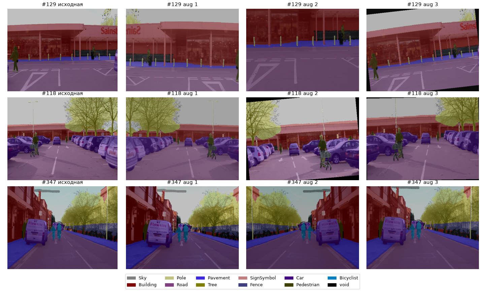
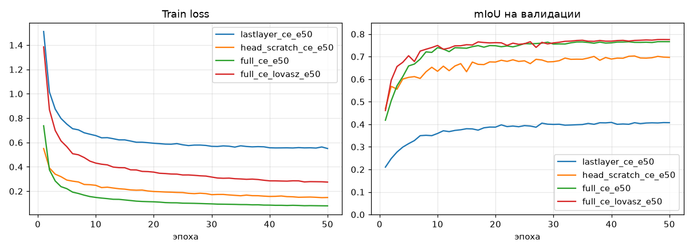
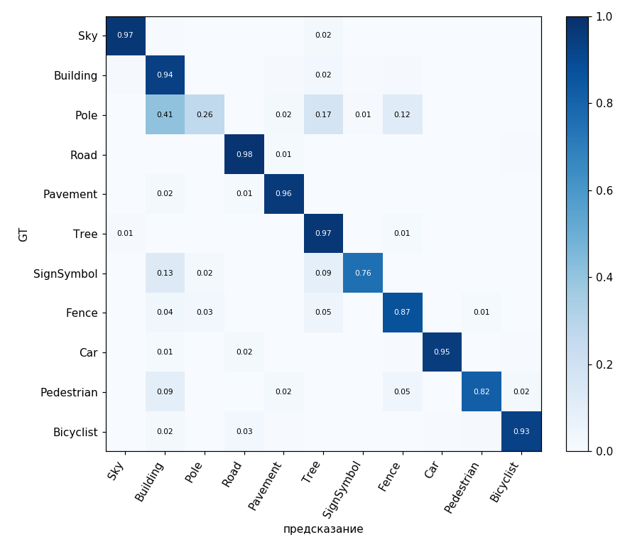
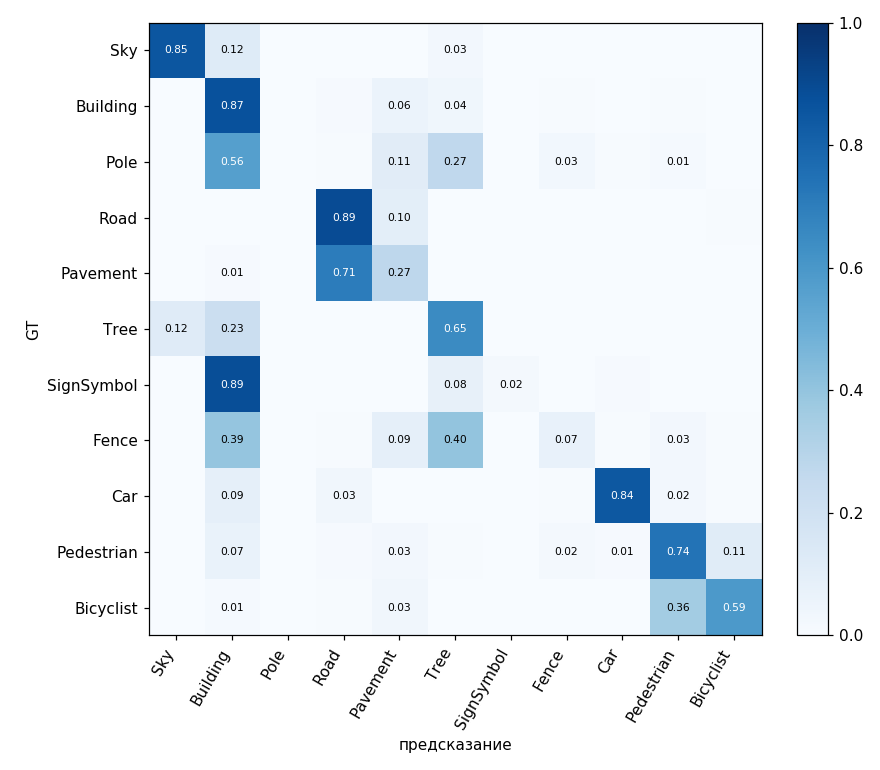
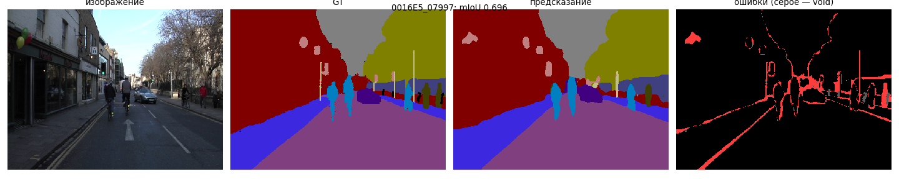
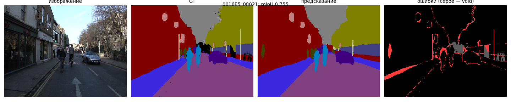
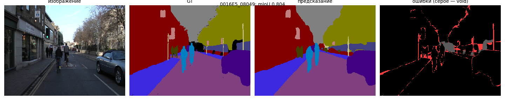

# Дообучение модели сегментации под новые классы (CamVid)

**Итоговая модель:** DeepLabV3-ResNet50 (веса COCO/VOC), дообученная целиком на 11 классов CamVid с функцией потерь CE + Lovász — `full_ce_lovasz_e50`.

| Модель | Что обучается | mIoU, val | mIoU, test |
|---|---|---|---|
| `lastlayer_ce_e50` | только выходной слой | 0.409 | 0.404 |
| `head_scratch_ce_e50` | вся голова DeepLabHead, энкодер заморожен | 0.703 | 0.596 |
| `full_ce_e50` | вся модель | 0.766 | 0.685 |
| **`full_ce_lovasz_e50`** | вся модель, CE + Lovász | **0.776** | **0.695** |

Все варианты: 50 эпох, батч 4, seed 42

## 1. Загрузка изображений и масок, классы, аугментации

**Датасет:** CamVid в версии SegNet-Tutorial: 367 / 101 / 233 кадров (train / val / test), 480×360. Маски одноканальные, значение пикселя — индекс класса. Индекс 11 (void) не учитывается ни в loss, ни в метрике.

| Индекс | 0 | 1 | 2 | 3 | 4 | 5 | 6 | 7 | 8 | 9 | 10 | 11 |
|---|---|---|---|---|---|---|---|---|---|---|---|---|
| Класс | Sky | Building | Pole | Road | Pavement | Tree | SignSymbol | Fence | Car | Pedestrian | Bicyclist | void |

**Проверка соответствия** (`check_augs.py`):
- имена картинок и масок попарно совпадают во всех сплитах;
- значения масок после аугментаций лежат в {0…11}, тип int64, размер маски совпадает с размером картинки;
- батчи собираются: train `(4, 3, 352, 480)`, val `(4, 3, 360, 480)`;
- на наложении маски на кадр видно, что объекты совпадают после кропа, отражения и поворота (рис. 1).

**Совместные геометрические аугментации** (`torchvision.transforms.v2`). Картинка (`tv_tensors.Image`) и маска (`tv_tensors.Mask`) передаются в одно преобразование, поэтому получают одинаковые случайные параметры. Маска интерполируется ближайшим соседом, чтобы не появлялись несуществующие индексы.

| Преобразование | Параметры | Применяется к маске |
|---|---|---|
| RandomResizedCrop | 352×480, scale 0.5–1.0 | да, nearest |
| RandomHorizontalFlip | p = 0.5 | да |
| RandomAffine (поворот) | ±10°, p = 0.3 | да, nearest; пиксели за краем → void |
| ColorJitter | яркость, контраст, насыщенность 0.3 | нет |
| Normalize | ImageNet mean/std | нет |

На валидации и тесте — только нормализация, кадр подаётся целиком (360×480).

## 2. Готовая модель и настройка выхода под число классов

**Модель:** `torchvision` DeepLabV3-ResNet50, веса `DeepLabV3_ResNet50_Weights.COCO_WITH_VOC_LABELS_V1`: энкодер предобучен на ImageNet, вся сеть — на изображениях COCO с 20 классами VOC + фон (21 выход).

- Выходной слой `classifier[4]` = `Conv2d(256, 21, 1)` заменён на `Conv2d(256, 11, 1)` со случайной инициализацией.
- Вспомогательная голова `aux_classifier` отключена.
- Итог: 39.64 M параметров, 107.8 GMACs на кадр 360×480.

Классы почти не пересекаются: в VOC есть Car, Pedestrian (person) и частично Bicyclist (person + bicycle), а небо, здания, дорога, тротуар, деревья, столбы, знаки и заборы в VOC относились к одному классу «фон». Поэтому старые 21 класс не сохраняются, и модель учится различать новые классы.

## 3. Обучение только выходной головы и дообучение всей модели

**Варианты.** По материалу задания (D2L, Fine-Tuning) у классификатора заменяется выходной слой `fc`. Его прямой аналог в DeepLabV3 — свёртка 1×1 `classifier[4]` (`lastlayer`). Перед ней у DeepLabV3 стоит большой блок ASPP, поэтому дополнительно проверено обучение всей головы DeepLabHead с нуля при замороженном энкодере (`head_scratch`).

| | `lastlayer` | `head_scratch` | `full` |
|---|---|---|---|
| ResNet-50 | заморожен | заморожен | учится, LR 1e-4 |
| ASPP + conv 3×3 | заморожены (веса COCO) | новые, LR 1e-3 | учатся, LR 1e-4 |
| выходной слой | новый, LR 1e-3 | новый, LR 1e-3 | новый, LR 1e-3 |
| Обучаемых параметров | 2 827 | 16.13 M | 39.64 M |
| BatchNorm | все в `eval()` | энкодер `eval()`, голова `train()` | все `train()` |

**Одинаковый бюджет:** 50 эпох, батч 4, seed 42, AdamW (wd 1e-4), poly-расписание LR, AMP fp16. Для честного сравнения все три варианта обучены с одной функцией потерь CE. Лучшая эпоха выбирается по val.

| Метрика | `lastlayer` | `head_scratch` | `full` |
|---|---|---|---|
| **mIoU, val** | 0.409 | 0.703 | **0.766** |
| **mIoU, test** | 0.404 | 0.596 | **0.685** |
| Лучшая эпоха | 40 | 44 | 49 |
| Время эпохи | 6.2 с | 9.8 с | 19.7 с |
| Время обучения | 7.7 мин | 10.2 мин | 18.3 мин |
| Пиковая память обучения | 420 МБ | 626 МБ | 2 102 МБ |

**Выводы:**
- **Одного выходного слоя недостаточно:** 0.40 mIoU. Замороженный ASPP, обученный на VOC, сводит дорогу, тротуар, знаки, столбы и заборы к одному «фону», и линейный слой после него их не разделит.
- **Переобучение всей головы** даёт 0.70 на val. Это 82% разрыва `lastlayer`–`full` на val, но только 68% на test: признаков замороженного энкодера не хватает на незнакомых улицах.
- **Дообучение всей модели** лучше всех: +0.06 на val и +0.09 на test к `head_scratch`. Цена — вдвое более долгая эпоха и в 3.4 раза больше памяти обучения.

**Итоговая модель.** Для `full` дополнительно проверены функции потерь (раздел 6.2). Лучшей оказалась CE + Lovász: **0.776 val, 0.695 test**. Она используется дальше как основная модель и как исходная для задачи прунинга.

**Сохранённые веса:** `runs/<имя>/best.pt` (лучшая эпоха по val) и `runs/<имя>/last.pt` для каждого запуска.

## 4. mIoU на валидации и разбор ошибок

Разбор сделан скриптом `analyze.py` для итоговой модели `full_ce_lovasz_e50`.

**mIoU val 0.776, pixel accuracy 0.952.**

| Класс | IoU val | IoU test |
|---|---|---|
| Road | 0.973 | 0.954 |
| Sky | 0.931 | 0.902 |
| Building | 0.906 | 0.837 |
| Tree | 0.904 | 0.761 |
| Pavement | 0.896 | 0.847 |
| Car | 0.881 | 0.897 |
| Bicyclist | 0.846 | 0.684 |
| Fence | 0.731 | 0.395 |
| SignSymbol | 0.641 | 0.501 |
| Pedestrian | 0.631 | 0.599 |
| Pole | **0.194** | **0.269** |

**Как читать матрицу.** Строка — истинный класс, столбец — предсказанный. Клетка (A, B) — доля пикселей класса A, названных классом B. Диагональ — доля верно размеченных пикселей класса.

**Самые частые путаницы:**

| Истинный класс → предсказание | Доля пикселей класса |
|---|---|
| Pole → Building | 0.41 |
| Pole → Tree | 0.17 |
| SignSymbol → Building | 0.13 |
| Pole → Fence | 0.12 |
| Pedestrian → Building | 0.09 |
| SignSymbol → Tree | 0.09 |

**Ошибка 1. Ошибки сосредоточены на границах объектов.** Полоса ±3 пикселя вокруг границ классов занимает 15.9% пикселей, но содержит **79%** всех ошибок. Классы распознаются, внутренние области размечаются верно, а ошибки остаются на краях. Причина в архитектуре: DeepLabV3 предсказывает на сетке в 8 раз грубее входа (45×60 для кадра 360×480) и восстанавливает разрешение интерполяцией, без декодера.

**Ошибка 2. Столбы — самый слабый класс** (IoU 0.19 val). Столб шириной 2–4 пикселя уже одной ячейки выходной сетки и растворяется в фоне за ним: 41% его пикселей названы зданием, 17% — деревом, 12% — забором. Почти все пиксели столба — граничные.

**Ошибка 3. Мелкие объекты путаются с фоном за ними:** знаки и пешеходы — со зданиями (0.13 и 0.09), знаки — с деревьями (0.09).

**Для сравнения — `lastlayer`** (рис. 4). Ошибки другого типа: только 33% ошибок на границах. Модель вообще не распознаёт классы, которых нет в VOC: знаки называет зданием (0.89), тротуар — дорогой (0.71), заборы — деревом или зданием (0.40 / 0.40), велосипедиста — пешеходом (0.36). Это ошибки распознавания целых областей, а не границ.

**Примеры кадров итоговой модели** (mIoU кадра по присутствующим на нём классам). Слева направо: кадр, разметка, предсказание, ошибки (красные — неверные пиксели, серые — void).

| Худшие | Медианный | Лучшие |
|---|---|---|
| 0016E5_07997 (0.696), 0016E5_08065 (0.714), 0016E5_08001 (0.717) | 0016E5_08021 (0.755) | 0016E5_08049 (0.804), 0016E5_08133 (0.803), 0016E5_08157 (0.803) |

<!-- Добавить 1–2 предложения: что видно на худшем кадре -->

<!-- Проверить описание по рис. 7 -->
На лучшем кадре дорога, тротуар, здания, деревья, небо, машина и велосипедисты размечены правильно целиком. Ошибки — тонкие линии вдоль границ и полосы на месте столбов. Это те же два типа ошибок, что и по всей валидации.

- Качество по кадрам ровное: от 0.70 до 0.80, медиана 0.755, провальных сцен нет.
- Худшие кадры одинаковы у всех моделей `full` (07997, 08065): трудность в самой сцене.

**Вывод разбора.** Итоговой модели не хватает пространственного разрешения на тонких и мелких объектах. Улучшать её дальше имеет смысл архитектурой с декодером (DeepLabV3+) или увеличенным входом, а не дообучением.

## 5. Исходные показатели качества, скорости и памяти

Модель `runs/full_ce_lovasz_e50/best.pt` (эпоха 49). Замеры: `bench.py`, batch 1, вход 360×480, 20 прогревочных и 100 замеренных прогонов, медиана.

| Показатель | RTX 4050 Laptop | RTX 3050 (задача 2) |
|---|---|---|
| mIoU val / test | 0.776 / 0.695 | 0.776 / 0.695 |
| Параметры | 39.64 M | 39.64 M |
| Вычисления | 107.8 GMACs | 107.8 GMACs |
| Задержка fp32 / fp16 | 28.7 / 16.0 мс | 38.2 / 21.9 мс |
| Память инференса fp32 | ~250 МБ | 232 МБ |
| Время эпохи / обучения | 22.0 с / 20.2 мин | — |
| Пиковая память обучения | 2 309 МБ | — |

- На обеих машинах используется один и тот же чекпойнт, поэтому качество совпадает.
- Параметры и MACs от машины не зависят, задержка зависит. Сокращённые модели в задаче 2 сравниваются с исходной на одной машине (RTX 3050).

## 6. Дополнительные эксперименты

### 6.1. Голова с весами COCO вместо головы с нуля

| Запуск | ASPP | mIoU val |
|---|---|---|
| `head_pretrained_lr1e-3_ce_e50` | старт с COCO, LR 1e-3 | 0.708 |
| `head_scratch_ce_e50` | с нуля, LR 1e-3 | 0.703 |
| `head_pretrained_lr1e-4_ce_e50` | старт с COCO, LR 1e-4 | 0.699 |

Предобученная голова не даёт преимущества: разница в пределах шума (±0.01). С малым LR результат хуже: признаки «фона» VOC нужно сильно перестраивать. Полезная часть предобучения для CamVid — энкодер.

### 6.2. Функции потерь для `full`

| Запуск | Функция потерь | mIoU val | mIoU test | test + flip-TTA |
|---|---|---|---|---|
| `full_ce_e50` | CE | 0.766 | 0.685 | 0.690 |
| `full_wce_e50` | CE, веса классов по median frequency | 0.743 | 0.665 | 0.671 |
| **`full_ce_lovasz_e50`** | CE + Lovász-softmax | **0.776** | **0.695** | **0.700** |

- **Взвешенная CE ухудшает mIoU на 0.02.** Recall редких классов растёт, но модель начинает ставить их там, где их нет (Fence → Pole, SignSymbol → Pole), а Bicyclist с самым большим весом теряет 0.10 на val. IoU штрафует ложные срабатывания так же, как пропуски.
- **CE + Lovász даёт +0.010** на val и на test, в основном на слабых классах (test): Pole +0.031, Fence +0.027, Bicyclist +0.026, Pedestrian +0.022. Цена — около 12% времени эпохи, инференс не меняется.
- **Flip-TTA** (сумма логитов кадра и его зеркальной копии) добавляет ~0.005, но удваивает время инференса.

### 6.3. Валидация и тест

Валидация оптимистичнее теста на 0.08–0.11 mIoU у всех обучаемых моделей: валидационные кадры взяты из той же видеопоследовательности, что и часть обучающих, а тест — из других поездок. Порядок моделей на val и test одинаковый, поэтому val подходит для выбора эпохи и сравнения, а итоговое качество честнее оценивать на тесте.

### 6.4. Воспроизводимость

Все эксперименты повторены на RTX 3050 и RTX 4050 Laptop. mIoU val совпадает с разбросом до 0.006 (`lastlayer` — до последнего знака), выводы одинаковые. Разброс при повторном запуске на одной машине — около 0.002 (недетерминизм cuDNN).

## 7. Выводы

1. Загрузка, соответствие классов и совместные аугментации картинки и маски проверены: маски остаются в {0…11} и совпадают с объектами после геометрических преобразований.
2. Готовая DeepLabV3-ResNet50 (COCO/VOC, 21 класс) настроена на 11 классов CamVid заменой выходной свёртки.
3. При одинаковом бюджете обучение только выходного слоя даёт 0.40 mIoU, всей головы — 0.70 / 0.60 (val / test), всей модели — 0.77 / 0.69. При смене домена (VOC → городские сцены) нужно дообучать как минимум всю голову, а для переноса на новые сцены — и энкодер.
4. Итоговая модель — дообучение всей сети с CE + Lovász: 0.776 val, 0.695 test. 79% её ошибок — на границах объектов, самый слабый класс — столбы (IoU 0.19–0.27). Это ограничение архитектуры с грубой выходной сеткой.
5. Исходные показатели для задачи 2: 39.64 M параметров, 107.8 GMACs, 38.2 / 21.9 мс (fp32 / fp16, RTX 3050), 232 МБ памяти инференса.

## 8. Код и воспроизведение

Команды запуска — в [README.md](../README.md#задача-1-дообучение), логи — в `logs/finetuning/`, веса и `summary.json` — в `runs/<имя запуска>/`.